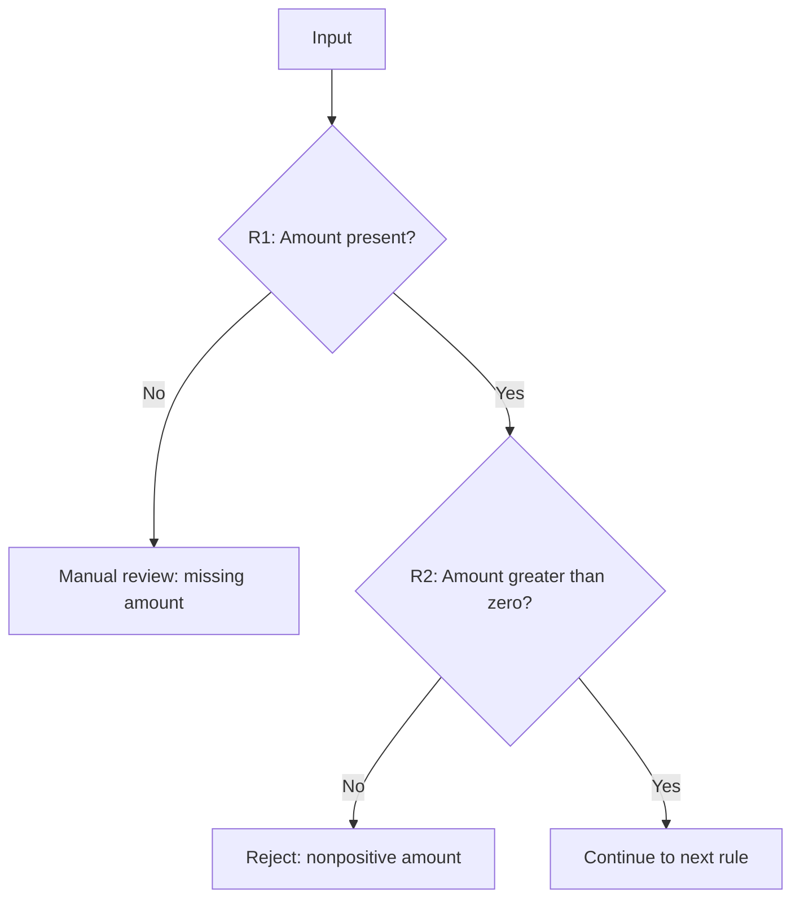

# Diagram mapping

Use this workflow for diagrams in chat and Markdown documents, especially requests to map all conditions, business rules, or decision paths. A sequence of stage names is an overview, not a condition map. Match the requested depth; a request for a simple overview does not need an exhaustive rule inventory.

## 1. Establish the source and scope

Read the relevant material with available tools before drawing. For a saved specification, use getFileList/getFileContent. For implemented behavior, use queryCodebase with a focused question about the relevant evaluator, its callers, configuration, and tests. Reuse already-read material when it is still available and sufficient; do not repeat broad scans. Tool activity counts are not proof of coverage.

Separate specified behavior from implemented behavior. If they differ, identify the difference rather than combining them into one apparently authoritative map. Follow the reading policy when a repository investigation is incomplete: draw only the supported portion, label it partial, and name the missing sources. Do not invent rules, thresholds, field names, IDs, or fallback behavior to make a diagram appear complete.

## 2. Inventory before drawing

For a condition map, build a compact inventory from the sources:
- Rule ID or exact source location; if none exists, use a clearly labeled local reference such as R1.
- Exact predicate, including operands, operators, units, thresholds, AND/OR grouping, and applicable configuration.
- Evaluation order and prerequisites, including early exits, rules skipped after a failure, and rules that continue independently.
- Every supported outcome: pass, fail, missing/invalid input, exception, manual review, retry, or fallback. Include only outcomes evidenced by the source.

For architecture, inventory actual components, boundaries, connections, and data/control flow instead. The coverage checklist must fit the diagram type; do not force decision diamonds into a component diagram.

## 3. Draw the requested logic

Use fenced mermaid blocks. Decision predicates belong in diamonds, actions in rectangles, and terminal results in clearly named end nodes. Label outgoing decision edges with the actual outcomes (yes/no, match/no match, or source-defined values). Connect failures to their real results, not a generic error box that hides different behavior. Show success paths as well as failures.

Preserve semantics when shortening labels: include a rule reference and enough of the predicate to understand the decision. Put long expressions in the accompanying rule table, linked by the same reference. Never replace the conditions with labels like Configuration, Eligibility, or Validation alone.

For a large map, provide a small overview plus detailed diagrams by stage or subgraph. Label the overview explicitly. Continue the detailed maps in the same response when requested; do not stop at an overview and ask whether the user wants the detail they already requested. Name entry/exit links between diagrams so paths remain traceable. Print readability is a reason to split diagrams, not omit logic.

Use quoted labels, unique node IDs, and supported Mermaid syntax. Do not use HTML, scripts, click actions, or configuration directives. Keep the Mermaid source in saved Markdown so previews, expanded views, and PDF exports render the same logic.

## 4. Verify coverage before presenting

Compare the inventory against the diagrams, rule by rule:
- Every in-scope rule maps to a node or an explicitly linked detailed diagram.
- Every evidenced branch reaches the correct result or continuation.
- Ordering, AND/OR logic, early exits, and skipped evaluations match the source.
- Every node and edge has source support; unknowns are labeled rather than guessed.

Fix omissions before answering. Include a compact table with Rule | Condition | Outcomes | Diagram node | Source when the user requests all rules or conditions. State any unverified scope. Only claim complete coverage if the inventory and sources justify it; a rendered SVG proves syntax, not completeness. If execution tests were not run, say the mapping was checked against source rather than claiming runtime validation.

## Example of detail, not application-specific rules

Suppose a supplied spec says an amount must exist, then be positive; missing input goes to review and a nonpositive amount is rejected. A stage-only box called Amount validation loses two distinct outcomes. The decision map should instead show:

These example rules are illustrative only. Never copy them into the user's map unless their sources establish them.
